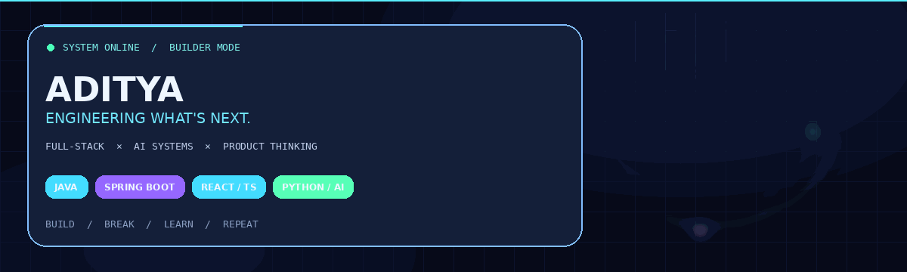

### `FULL-STACK ENGINEER` · `AI BUILDER` · `SYSTEMS THINKER`

*I turn messy ideas into useful software — then keep making it better.*

---

## `01 / THE OPERATOR`

I'm Aditya — a third-year BTech student building across full-stack engineering, backend systems, and applied AI.

I care about the part after the demo: **reliability, architecture, useful UX, and making the thing actually work.**

- ⚙️ **Backend:** Java, Spring Boot, Python, FastAPI, REST APIs
- 🧪 **Frontend:** React, TypeScript, JavaScript, HTML/CSS
- 🧠 **AI / ML:** LLM integrations, model experimentation, AI-powered workflows
- 🗄️ **Data & tooling:** SQL, MongoDB, Git, Docker, API testing
- 🎯 **Current mission:** build software that is useful, explainable, and production-minded

> I like ambitious ideas. I like clean execution even more.

## `02 / ACTIVE MISSIONS`

<table>
<tr>
<td width="50%" valign="top">

### ◈ AI MON
**API observability · AI-assisted debugging**

A smart API monitoring project built around scheduled health checks, anomaly detection, failure analysis, alerting, and a live dashboard.

`FastAPI` `React` `TypeScript` `SQLAlchemy` `WebSockets`

[↗ Explore repository](https://github.com/theadiisingh/ai-mon)

</td>
<td width="50%" valign="top">

### ◈ THE NEXT BUILD
**Prototype → product**

I’m interested in taking rough ideas beyond a flashy demo: stronger architecture, better developer experience, and measurable reliability.

`Design` `Engineering` `Iteration`

[↗ Browse all repositories](https://github.com/theadiisingh?tab=repositories)

</td>
</tr>
</table>

## `03 / LOADOUT`

## `04 / THE BUILD QUEST` 🎮

*Treat the craft like a game. The XP is earned by shipping, not by collecting badges.*

| Quest | XP | Clear condition |
|:--|--:|:--|
| **API Architect** | `+100 XP` | Ship an API with validation, auth, and clear docs |
| **Reliability Engineer** | `+150 XP` | Add tests, health checks, logging, and failure handling |
| **AI Integrator** | `+150 XP` | Build an AI feature with a useful fallback path |
| **Open Source Signal** | `+200 XP` | Make a meaningful contribution others can use |
| **Product Finisher** | `+250 XP` | Deploy a project and document how it works |

**Current rank:** `ROOKIE → SYSTEMS BUILDER → SHIPPER → ARCHITECT`

> **How to play:** pick a quest, ship the proof in a public repo, and update this board. No fake XP counters — only work you can click through and inspect.

<b>▶ Unlock the next level</b>

- [ ] Add meaningful automated tests to a featured project
- [ ] Publish a live demo with a clear README
- [ ] Document one architecture decision and its trade-offs
- [ ] Make a useful open-source contribution
- [ ] Release a project update based on real user feedback

## `05 / SIGNALS`

Stats are provided by third-party services and may occasionally be unavailable. Language percentages describe repository contents, not skill level.

## `06 / CONNECT`

**Have a thoughtful problem, a strange idea, or a project worth building?**

---

`DESIGNED TO EVOLVE` · `BUILT IN PUBLIC` · `NO FINISH LINE`

Thanks for dropping into my corner of the internet.

